# Lab 08 — Microsoft Entra ID PIM: Privileged Identity Management & Just-In-Time Access

## 1. Descripción del proyecto

**Referencia: La que se avecina — Temporada 2, episodio 11: «Un datáfono, un suicida y un presidente en las últimas».**

En este episodio, Amador Rivas atraviesa una crisis personal y económica después de descubrir la infidelidad de su mujer. La situación termina llevándole a abandonar el domicilio familiar y trasladarse a casa de Leo.

Mientras tanto, en Mirador de Montepinar se desarrolla un conflicto que afecta directamente a toda la comunidad. El presidente acepta una oferta de 60.000 euros a cambio de permitir la instalación de una antena de telefonía móvil en el edificio. Sin embargo, decide quedarse con la mitad del dinero y tratar de ocultar la operación al resto de los vecinos.

Cuando el fraude sale a la luz, estalla el enfrentamiento entre los vecinos. Enrique Pastor inicia una oposición contra Amador para apartarlo de la presidencia y Antonio Recio también decide presentarse como candidato. La gestión de la comunidad queda marcada por la desconfianza y la disputa por el control de las decisiones.

Esta situación sirve como punto de partida para el laboratorio. El episodio muestra cómo una persona con autoridad puede tomar decisiones importantes en nombre de una organización sin que existan controles adecuados sobre el ejercicio de sus responsabilidades.

Tras los problemas de gestión de la comunidad, Mirador de Montepinar S.L. decide revisar el modelo de administración de sus recursos digitales. Durante una auditoría interna, la empresa detecta que algunas cuentas mantienen permisos administrativos permanentes, incluso cuando sus propietarios no necesitan utilizarlos en su actividad diaria.

Esta situación representa un riesgo para la seguridad de la organización: una cuenta comprometida o un uso indebido de privilegios podría permitir realizar cambios críticos sin una necesidad operativa justificada.

Para abordar este problema, la empresa decide implantar **Microsoft Entra Privileged Identity Management (PIM)** y adoptar un modelo de acceso **Just-In-Time (JIT)**.

Mediante PIM, los usuarios dispondrán de asignaciones elegibles (*Eligible*) y tendrán que solicitar la activación de sus privilegios cuando necesiten realizar tareas administrativas. Estas activaciones estarán sujetas a requisitos de autenticación multifactor (MFA), justificación, aprobación y una duración limitada.

De esta forma, Mirador de Montepinar S.L. busca reducir la exposición de los privilegios elevados y establecer un mayor control sobre quién puede utilizarlos, cuándo y bajo qué condiciones.

## 2. Objetivos del proyecto

El laboratorio tiene los siguientes objetivos:

1. Comprender el funcionamiento de Microsoft Entra Privileged Identity Management.
2. Identificar los riesgos de mantener asignaciones administrativas permanentes.
3. Configurar asignaciones elegibles (*Eligible*) para roles administrativos.
4. Implementar el modelo de acceso Just-In-Time (JIT).
5. Configurar requisitos de MFA, justificación y aprobación para activar privilegios.
6. Establecer límites temporales para las activaciones administrativas.
7. Comprobar los flujos de solicitud, aprobación y expiración de privilegios.
8. Consultar los registros de auditoría para verificar las operaciones realizadas.
9. Aplicar el principio de mínimo privilegio en la administración del entorno.

## 3. Arquitectura del proyecto

El laboratorio utiliza un entorno híbrido compuesto por identidades procedentes de Active Directory local y una cuenta creada directamente en Microsoft Entra ID.

La arquitectura se organiza de la siguiente manera:

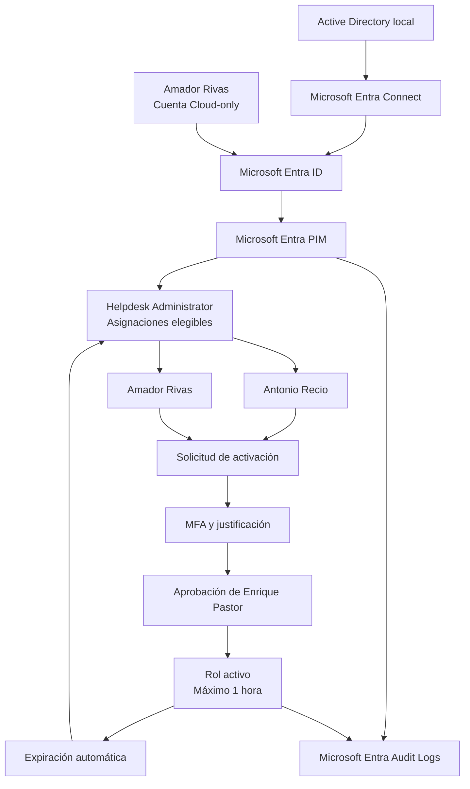

**Identidades utilizadas:**

| Identidad | Origen | Función en el laboratorio |
|---|---|---|
| Antonio Recio (arecio) | Active Directory local | Usuario con asignación elegible |
| Enrique Pastor (epastor) | Active Directory local | Aprobador de las solicitudes |
| Amador Rivas (arivas) | Microsoft Entra ID (Cloud-only) | Usuario con asignación elegible |

**Configuración principal:**

- Plataforma de gestión: Microsoft Entra Privileged Identity Management.
- Rol seleccionado: Helpdesk Administrator (Administrador del departamento de soporte técnico).
- Ámbito: directorio de Microsoft Entra ID.
- Asignaciones elegibles: Antonio Recio y Amador Rivas.
- Aprobador: Enrique Pastor.
- Duración máxima de activación: una hora.
- Requisitos de activación: MFA, justificación y aprobación.
- Registro de operaciones: Microsoft Entra Audit Logs.

El flujo permite que Antonio y Amador soliciten la activación del rol cuando necesitan realizar una tarea de soporte. Enrique revisa y aprueba las solicitudes. Una vez activados, los privilegios expiran automáticamente al finalizar el periodo configurado.

## 4. Fases de implementación

### Fase 1. Preparación del entorno y asignación de identidades

Se preparó el entorno de Microsoft Entra ID para realizar las pruebas de Privileged Identity Management (PIM).

Se utilizaron tres identidades de Mirador de Montepinar:

- **Antonio Recio (arecio):** usuario sincronizado desde Active Directory local.
- **Enrique Pastor (epastor):** usuario sincronizado desde Active Directory local y designado como aprobador.
- **Amador Rivas (arivas):** usuario creado directamente en Microsoft Entra ID.

Se habilitaron las licencias de evaluación necesarias para trabajar con PIM y se comprobó que las tres identidades podían iniciar sesión. También se verificó el registro de Microsoft Authenticator para los usuarios que participarían en las activaciones.

### Fase 2. Configuración de Privileged Identity Management

Se accedió a Privileged Identity Management desde Microsoft Entra ID y se seleccionó el rol **Helpdesk Administrator (Administrador del departamento de soporte técnico)**.

Este rol permite realizar determinadas operaciones de soporte sobre usuarios, como restablecer contraseñas e invalidar tokens de actualización, sin conceder privilegios de administración global.

Se configuró a Antonio Recio y Amador Rivas con asignaciones elegibles (*Eligible*) de carácter permanente. De este modo, ambos podían solicitar la activación del rol cuando necesitasen realizar una tarea que requiriese esos privilegios.

En la configuración del rol se establecieron las siguientes condiciones:

- Duración máxima de activación: **1 hora**.
- Justificación obligatoria para solicitar la activación.
- MFA obligatoria durante la activación.
- Aprobación obligatoria antes de conceder los privilegios.
- Enrique Pastor como aprobador designado.
- Requisito de MFA también habilitado para las asignaciones activas.

### Fase 3. Solicitud y aprobación de privilegios de Antonio Recio

Se inició sesión con la cuenta de Antonio Recio y se accedió a PIM para consultar sus asignaciones elegibles.

Antonio solicitó activar el rol Helpdesk Administrator durante una hora. Para ello, tuvo que proporcionar una justificación que explicase el motivo de la solicitud:

> Necesito activar temporalmente el rol de administrador del departamento de soporte técnico para resolver un caso comunitario muy urgente. Estoy tras la pista del moroso!

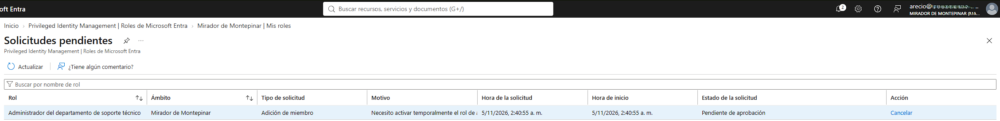

La petición quedó pendiente de aprobación. Posteriormente, se inició sesión con Enrique Pastor, que accedió a las solicitudes de aprobación de roles de Microsoft Entra y revisó la petición.

Enrique aprobó la activación, añadiendo su propia justificación:

> Aprobación concedida. Tienes una hora para resolver el asunto del moroso, ni un minuto más!

Una vez aprobada, Antonio recibió los privilegios de Helpdesk Administrator durante el periodo establecido.

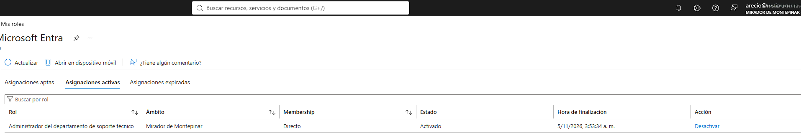

Se comprobó que el rol aparecía entre sus asignaciones activas y que podía acceder a la opción de restablecimiento de contraseñas de otros usuarios no administradores. No se llegó a ejecutar ningún restablecimiento.

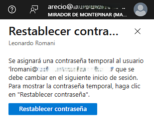

### Fase 4. Solicitud y aprobación de privilegios de Amador Rivas

Se repitió el procedimiento con la cuenta de Amador Rivas para comprobar que el flujo de activación funcionaba también con una identidad creada directamente en Microsoft Entra ID.

Amador solicitó la activación temporal de Helpdesk Administrator e incluyó la siguiente justificación:

> Solicito activar los privilegios para recuperar a mis niños!

Enrique Pastor recibió la petición y volvió a actuar como aprobador. Tras revisar la solicitud, concedió la activación durante una hora, incorporando esta justificación:

> Solicitud concedida, en el fondo me das pena Amador... Un hombre consumido por el capitalismo

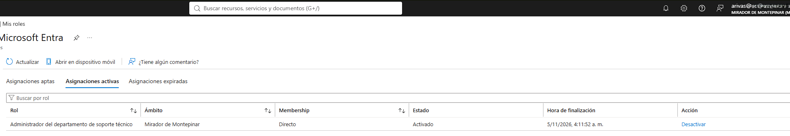

Se comprobó que Amador tenía el rol entre sus asignaciones activas y que podía acceder a la opción de restablecimiento de contraseñas de otros usuarios no administradores. Tampoco se ejecutó ningún cambio de contraseña.

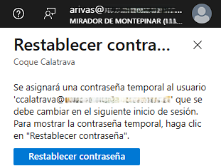

### Fase 5. Revisión de registros de auditoría

Se consultaron los registros de auditoría de Microsoft Entra ID para revisar la trazabilidad de las operaciones realizadas mediante PIM.

Se localizaron eventos correspondientes a:

- Creación de asignaciones elegibles permanentes.
- Solicitudes de activación de Antonio y Amador.
- Solicitudes de aprobación.
- Aprobaciones realizadas por Enrique Pastor.
- Activaciones completadas correctamente.

Los registros permitieron comprobar que ambas activaciones finalizaron correctamente y conservaron las justificaciones introducidas por los usuarios y el aprobador.

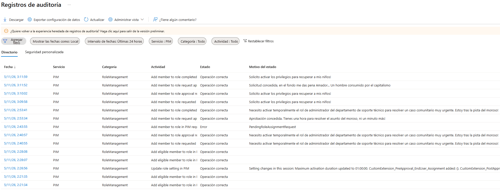

Durante la primera activación de Antonio se produjo un intento duplicado de solicitud. Al no aparecer una respuesta inmediata en el portal, se volvió a pulsar la opción de activación mientras ya existía una petición pendiente.

Microsoft Entra registró el segundo intento con el error `PendingRoleAssignmentRequest`. La solicitud original continuó su proceso y fue aprobada correctamente. Por tanto, se trató de un intento duplicado y no de un fallo en la configuración de PIM.

### Fase 6. Verificación de la expiración automática de privilegios

Una vez transcurrida la hora de activación, se comprobó el comportamiento de PIM con las dos identidades. En ambos casos se verificó que el rol había desaparecido de las asignaciones activas y que seguía disponible entre las asignaciones aptas (*Eligible*).

**Antonio Recio**

La activación finalizó a las **03:53 del 5 de noviembre de 2026**.

- El rol Helpdesk Administrator ya no aparecía entre sus asignaciones activas.

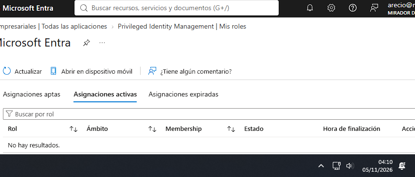

- La asignación seguía disponible entre sus asignaciones aptas.

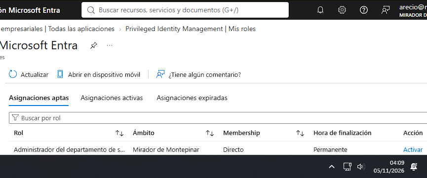

--- 

**Amador Rivas**

La activación finalizó a las **04:11 del 5 de noviembre de 2026**.

- El rol Helpdesk Administrator ya no aparecía entre sus asignaciones activas

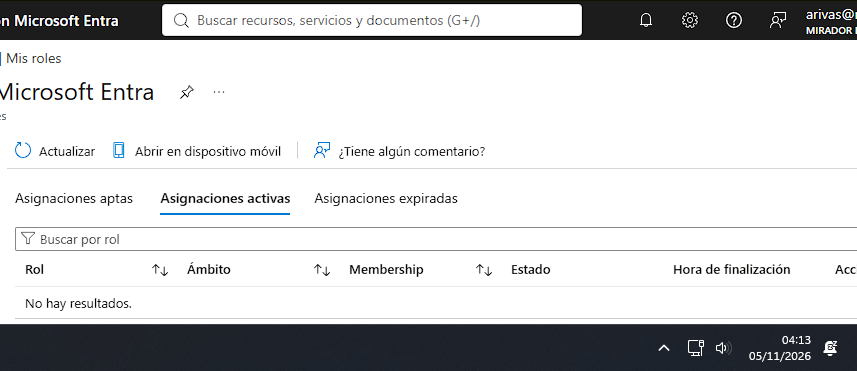

- La asignación seguía disponible entre sus asignaciones aptas.

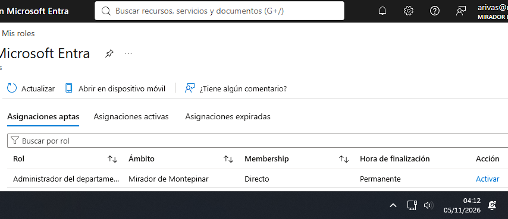

Las dos comprobaciones confirmaron que PIM retiró automáticamente los privilegios al finalizar el periodo de activación, sin eliminar la elegibilidad de los usuarios.

De esta forma, se validó el funcionamiento del acceso Just-In-Time (JIT): los usuarios pueden solicitar privilegios cuando los necesitan, pero no mantienen el acceso administrativo activo de forma permanente.

## 5. Resultados y validación

El laboratorio permitió comprobar el ciclo de gestión de privilegios con dos identidades de distinto origen: una sincronizada desde Active Directory local y otra creada directamente en Microsoft Entra ID.

| Comprobación | Antonio Recio | Amador Rivas |
|---|---|---|
| Origen de identidad | Active Directory local | Cloud-only |
| Asignación elegible | Correcta | Correcta |
| Solicitud de activación | Correcta | Correcta |
| Aprobación de Enrique | Correcta | Correcta |
| Activación del rol | Correcta | Correcta |
| Acceso a la opción de restablecimiento | Comprobado | Comprobado |
| Expiración automática | 03:53 | 04:11 |
| Conservación de la elegibilidad | Correcta | Correcta |

También se verificó que los registros de auditoría reflejaban las solicitudes, aprobaciones y activaciones de ambos usuarios, incluyendo las justificaciones introducidas durante el proceso.

**Resultado final:** las dos identidades pudieron utilizar temporalmente el rol Helpdesk Administrator previa aprobación de Enrique Pastor. Al terminar el periodo de activación, PIM retiró los privilegios activos y mantuvo las asignaciones elegibles.

## 6. Tecnologías utilizadas

| Tecnología o concepto | Aplicación en el laboratorio |
|---|---|
| Microsoft Entra ID | Gestión centralizada de identidades y roles. |
| Microsoft Entra Privileged Identity Management (PIM) | Gestión y activación temporal de privilegios. |
| Microsoft Entra Suite | Licenciamiento de evaluación del entorno. |
| Active Directory Domain Services (AD DS) | Origen de las identidades híbridas de Antonio y Enrique. |
| Microsoft Entra Connect | Sincronización de identidades entre Active Directory local y Entra ID. |
| Microsoft Authenticator | Autenticación multifactor de las cuentas participantes. |
| Microsoft Entra Audit Logs | Consulta y verificación de las operaciones realizadas. |
| Helpdesk Administrator | Rol administrativo utilizado en las pruebas. |
| Role-Based Access Control (RBAC) | Asignación de permisos mediante roles. |
| Just-In-Time Access (JIT) | Activación temporal de privilegios cuando son necesarios. |
| Multi-Factor Authentication (MFA) | Capa adicional de autenticación para las activaciones. |

**Competencias trabajadas:**

- Configuración y administración de Microsoft Entra PIM.
- Gestión de asignaciones elegibles y activas.
- Configuración de flujos de aprobación.
- Aplicación del principio de mínimo privilegio.
- Gestión de acceso temporal y reducción de privilegios permanentes.
- Verificación de permisos efectivos.
- Análisis de registros de auditoría y resolución de incidencias.

## 7. Próximas mejoras

El laboratorio permite ampliar las pruebas en futuras versiones para profundizar en la gestión de privilegios:

- **Rechazo de solicitudes:** comprobar qué ocurre cuando el aprobador rechaza una activación y verificar que el usuario conserva únicamente su asignación elegible.
- **Asignaciones elegibles con caducidad:** configurar asignaciones temporales en lugar de permanentes y comprobar su expiración.
- **Pruebas con otros roles administrativos:** comparar los permisos y riesgos asociados a distintos roles de Microsoft Entra ID.
- **PIM para recursos de Azure y grupos:** ampliar el escenario a otros ámbitos de administración de privilegios.
- **Automatización de auditorías:** utilizar Microsoft Graph o PowerShell para recopilar y analizar los registros de PIM.
- **Revisiones periódicas de acceso:** incorporar revisiones para comprobar que los usuarios siguen necesitando sus asignaciones elegibles.
